# Juan Felipe Medina

**Full-Stack Developer** &nbsp;·&nbsp; **Ready to hire, eager to learn** &nbsp;·&nbsp; **Colombia**

*Desarrollador Full-Stack &nbsp;·&nbsp; Listo para contratar y con ganas de aprender &nbsp;·&nbsp; Colombia*

 

  

 

 

## About &nbsp;/&nbsp; Sobre mí

I'm a full-stack developer based in Colombia with 3+ years building personal and client products
(since 2023), from analysis and design to deployment and maintenance. I work with supervised agentic
development, build automations and AI agents that take real actions, choose infrastructure for cost
and portability (I have migrated projects off Supabase, Render and Vercel) and document architecture
decisions. Ready to join a team and eager to keep learning.

- **Local and paid AI:** I work daily with paid models (Claude, OpenAI, Gemini) and local ones
  (Ollama running qwen3 on my own GPU), and I build tool-using agents and MCP servers.
- **Cloud training:** AWS Academy Graduate (Cloud Foundations and Cloud Developing) and 6 Google Cloud
  badges. **Languages:** Spanish native, English B2.

*Soy desarrollador full-stack en Colombia con más de 3 años construyendo productos propios y para
clientes (desde 2023), del análisis y el diseño hasta el despliegue y el mantenimiento. Trabajo con
desarrollo agéntico supervisado, construyo automatizaciones y agentes de IA que ejecutan acciones
reales, elijo la infraestructura por costo y portabilidad (he migrado proyectos fuera de Supabase,
Render y Vercel) y documento las decisiones de arquitectura. Listo para sumarme a un equipo y con
ganas de seguir aprendiendo.*

- ***IA local y de pago:** trabajo a diario con modelos de pago (Claude, OpenAI, Gemini) y locales
  (Ollama con qwen3 en mi propia GPU), y construyo agentes con herramientas y servidores MCP.*
- ***Formación en nube:** AWS Academy Graduate (Cloud Foundations y Cloud Developing) y 6 insignias
  de Google Cloud. **Idiomas:** español nativo, inglés B2.*

 

## GitHub Analytics &nbsp;/&nbsp; Estadísticas

  

  

  

 

## Hytrex &nbsp;/&nbsp; Mi grupo de desarrollo

**Co-founder & CEO.** Hytrex is a software development group I co-founded in Colombia. We turn ideas and
business problems into high-impact technology, combining strategy, design, engineering and delivery
into products that move a business rather than just demo well. Most of the work below runs on the
same principles the group is built on: clarity, purpose, impact.

*Cofundador y CEO. Hytrex es un grupo de desarrollo de software que cofundé en Colombia. Convertimos ideas
y problemas de negocio en tecnología de alto impacto, combinando estrategia, diseño, ingeniería y
ejecución en productos que mueven el negocio y no solo lucen bien en un demo. Buena parte del trabajo
de abajo corre sobre los mismos principios del grupo: claridad, propósito, impacto.*

 

## Certified Experience &nbsp;/&nbsp; Experiencia certificada

| Role · Rol | Where · Dónde | When · Cuándo |
|:--|:--|:--:|
| **Software Developer** — [GESTEK](https://github.com/BBMC-S-S-A/gestor-eventos-frontend), white-label event platform *Desarrollador de software — GESTEK, plataforma de eventos de marca blanca* | Develovers Group S.A.S. | `Mar–Jul 2026` |
| **Full-Stack Developer** — clinical web platform *Desarrollador full-stack — plataforma web clínica* | Consultorio Estético Dra. Julieth Medina | `2023–2026` |

**GESTEK — key highlight: FESTECH Ibagué 2026.** GESTEK ran the entire process of the City of
Ibagué's event (Sep 17–19), from registration and ticketing to door access control: **4,485 tickets,
3,334 check-ins, 1,555 people on the peak day and bursts of 67 entries in 5 minutes through a single
door.** My role: technical analysis, design, implementation and integration with supervised agentic
workflows. JWT-signed QR tickets, door control with re-entry, badge printing, Mercado Pago, an OAuth2
(PKCE) + MCP connector and 1,800+ automated tests. React + Vite (PWA) → Express 5 on cPanel → Supabase
Postgres, built with GitHub Actions.

*GESTEK — experiencia más destacada: FESTECH Ibagué 2026. GESTEK gestionó todo el proceso del evento de
la Alcaldía de Ibagué (17–19 sep.), desde el registro y la emisión de boletas hasta el control de
acceso en puerta: **4.485 boletas, 3.334 ingresos, 1.555 personas en el día pico y picos de 67 ingresos
en 5 minutos por una sola puerta.***

**Clinical platform (2023–2026).** I owned analysis, design, development, launch and maintenance:
booking, e-signed informed consent, admin analytics and an AI copilot; MCP server in integration.
Moved it off Supabase to Next.js 16 on Vercel → Express on Railway → Neon Postgres + Cloudflare R2
(about USD 5/month) with custom JWT auth.

*Plataforma clínica (2023–2026): a cargo de toda la plataforma, con agendamiento, consentimiento con
firma electrónica, analítica y copiloto de IA; la migré fuera de Supabase a Neon + R2 + Railway +
Vercel (unos 5 USD/mes) con autenticación propia.*

 

## Featured Projects &nbsp;/&nbsp; Proyectos destacados

| Project · Proyecto | What it is · Qué es | Architecture & tools · Arquitectura y herramientas |
|:--|:--|:--|
| **New Blood Premium BARF** | End-to-end sales automation for a dog-food company: order panel, an agent that closes the whole sale over WhatsApp and a daily reorder reminder. *Automatización de ventas para una empresa de alimento para perros: panel de pedidos, agente que atiende la venta completa por WhatsApp y aviso diario de recompra.* | React, Supabase, n8n, LangChain, OpenAI, Whapi.cloud. |
| **SorteosCCM** | Live raffle platform for the Colombian Paso Horse community. *Plataforma de rifas en producción para la comunidad del Caballo Colombiano de Paso.* | Angular 21 on Hostinger → Supabase (RLS, Edge Functions, pg_cron), Resend. |
| **Atenea** | AI agent microservice for any business: the client app defines profile, context and tools; the agent runs them through HMAC-signed webhooks. Fallback model, Whisper voice notes, token quotas, per-user history and a control panel. *Microservicio de agentes de IA para cualquier negocio: la app cliente define perfil, contexto y herramientas, y el agente las ejecuta por webhook firmado con HMAC.* | Node.js, TypeScript, Hono, PostgreSQL, Groq, Ollama, Anthropic, Whisper, Railway. |
| **MeDinero** | Personal finance PWA for iPhone: logs expenses by voice (Siri), receipt photo or bank notifications, tracks debts and installments, reads payslips; assistant with a 3D avatar powered by Atenea. *App de finanzas personales: gastos por voz, foto del recibo o avisos del banco, deudas y cuotas, lectura de nómina y asistente con avatar 3D sobre Atenea.* | Next.js 15, PostgreSQL with RLS, Better Auth, Tesseract.js (OCR), three.js, Railway. |
| [**DevUP**](https://github.com/BBMC-S-S-A/DevUP) | Command center for software teams: E2E-encrypted voice/video, tasks, credentials vault, MCP server. *Centro de mando para equipos: voz y video cifrados, tareas, bóveda de credenciales y servidor MCP.* | Fastify + Next.js 15, PostgreSQL 17 with RLS, WebRTC, Docker, Railway, Cloudflare Workers. |
| [**Ablaze**](https://github.com/BBMC-S-S-A/Ablaze) | Offline-first training PWA with a deterministic rule engine. *PWA de entrenamiento offline-first con motor de reglas determinista.* | Expo, SQLite WASM on OPFS, Express 5, Drizzle, PostgreSQL. |
| [**Wallnut**](https://github.com/Sekkon0906/wallnut) | Mobile campus platform: digitizes university activities and introduces a positive-points economy, QR attendance and a leaderboard. *Plataforma móvil del campus: digitaliza las actividades universitarias con una economía de puntos positivos, asistencia por QR y ranking.* | Expo / React Native, Express, hash-chained points ledger. |
| [**Ardy-IA**](https://github.com/Sekkon0906/Ardy-IA) | AI language tutor with RAG over indexed web search, conversation memory and voice input. *Tutor de idiomas con IA: RAG sobre búsqueda web indexada, memoria de conversación y entrada por voz.* | Python, FastAPI, Groq (Llama 3.1), ChromaDB, faster-whisper. |

<a href="https://github.com/Sekkon0906?tab=repositories">See all repositories · Ver todos los repositorios</a>

 

## Certifications &amp; Badges &nbsp;/&nbsp; Certificaciones e insignias

| Credential · Credencial | Issuer · Emisor | Date · Fecha | Verify · Verificar |
|:--|:--|:--:|:--:|
| **AWS Academy Graduate — Cloud Developing** · 40 h | Amazon Web Services | `Nov 2026` | [Credly](https://www.credly.com/go/V1s0sIQN) |
| **AWS Academy Graduate — Cloud Foundations** · 20 h | Amazon Web Services | `Apr 2025` | [Credly](https://www.credly.com/go/rGBo51yY) |
| **Introduction to Scrum Master Training** · 6 h | Coursera · LearnQuest | `Aug 2025` | [Coursera](https://coursera.org/verify/EB0KJ675QA3E) |
| **Google Cloud — 6 completion badges** Digital Transformation · Exploring Data Transformation · Innovating with AI · Infrastructure and Application Modernization · Trust and Security · Scaling with Operations | Google Cloud | `Apr 2025` | [Google Skills](https://www.skills.google/public_profiles/ca1e6001-8392-4f69-8495-a233333f2fcd) |

 

## Tech Stack &nbsp;/&nbsp; Tecnologías

**Languages** &nbsp;·&nbsp; *Lenguajes*

  

**Frontend** &nbsp;·&nbsp; *Frontend*

  

**Backend & Data** &nbsp;·&nbsp; *Backend y datos*

  

**Cloud & Infrastructure** &nbsp;·&nbsp; *Nube e infraestructura*

 

`Neon` `Railway` `Render` `Cloudflare Workers` `Cloudflare R2` `cPanel` `Hostinger` `Sentry`

  

**Tools** &nbsp;·&nbsp; *Herramientas*

 

## AI &amp; Automation &nbsp;/&nbsp; IA y automatización

I work with AI in the loop, not around it. Most things I build start with the question of what can
be automated, and increasingly that means writing **MCP servers inside the product** so an agent can
operate it directly instead of a person clicking through screens. GESTEK has an OAuth2 (PKCE) + MCP
connector, and the aesthetic clinic is integrating an MCP server that only an admin can authorize and that
asks for confirmation before writing.

*Trabajo con IA dentro del flujo, no alrededor. Casi todo lo que construyo empieza por la pregunta de
qué se puede automatizar, y cada vez más eso significa escribir **servidores MCP dentro del producto**
para que un agente lo opere directamente en vez de que una persona pase por pantallas. GESTEK tiene
un conector OAuth2 (PKCE) + MCP, y el consultorio estético está integrando un servidor MCP que solo un
administrador puede autorizar y que pide confirmación antes de escribir.*

**My AI development environment.** I feed it with my own Claude Code skills (architecture, UX, model
choice, legal radar and memory) that I use across all my repos, and with an Obsidian vault of about
400 notes that works as a **knowledge graph**: a map per project and a summary and importance level
per note, so the agent reads only what it needs. Every session leaves its log and decisions, and
audits run as multi-agent workflows (analyst and verifier). I run paid models (Claude, OpenAI, Gemini)
and local ones (Ollama with qwen3 on my own GPU).

*Mi entorno de desarrollo con IA. Lo alimento con skills propias para Claude Code (arquitectura, UX,
elección de modelo, radar legal y memoria) que uso en todos mis repos, y con una bóveda de Obsidian de
unas 400 notas que funciona como **grafo de conocimiento**: un mapa por proyecto y un resumen e
importancia por nota, para que el agente lea solo lo que necesita. Cada sesión deja su bitácora y sus
decisiones, y las auditorías corren con flujos multiagente (analista y verificador). Uso modelos de
pago (Claude, OpenAI, Gemini) y locales (Ollama con qwen3 en mi propia GPU).*

 

## Get in Touch &nbsp;/&nbsp; Contacto

Ready to join a development team, full-time or freelance, and eager to keep learning.

*Listo para sumarme a un equipo de desarrollo, a tiempo completo o freelance, y con ganas de seguir aprendiendo.*

 

 

 

 

